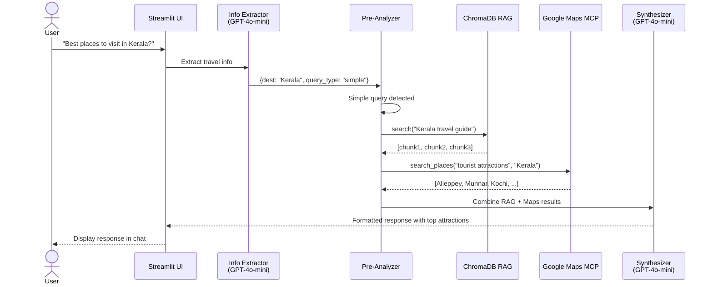
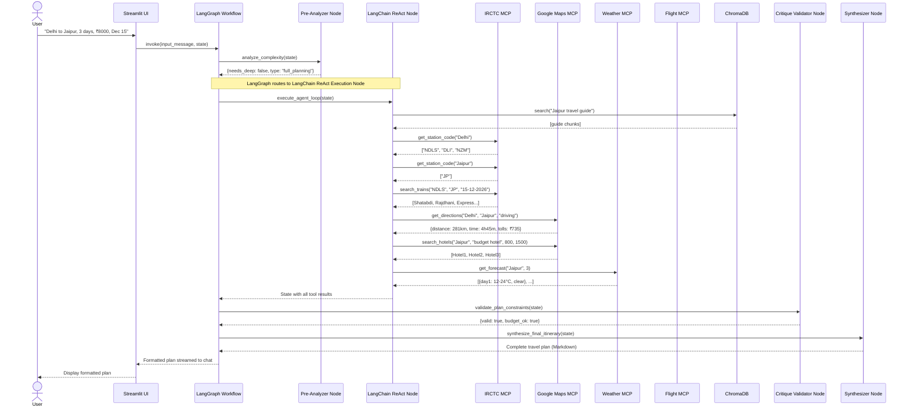
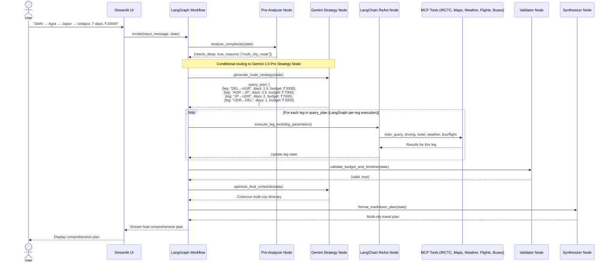
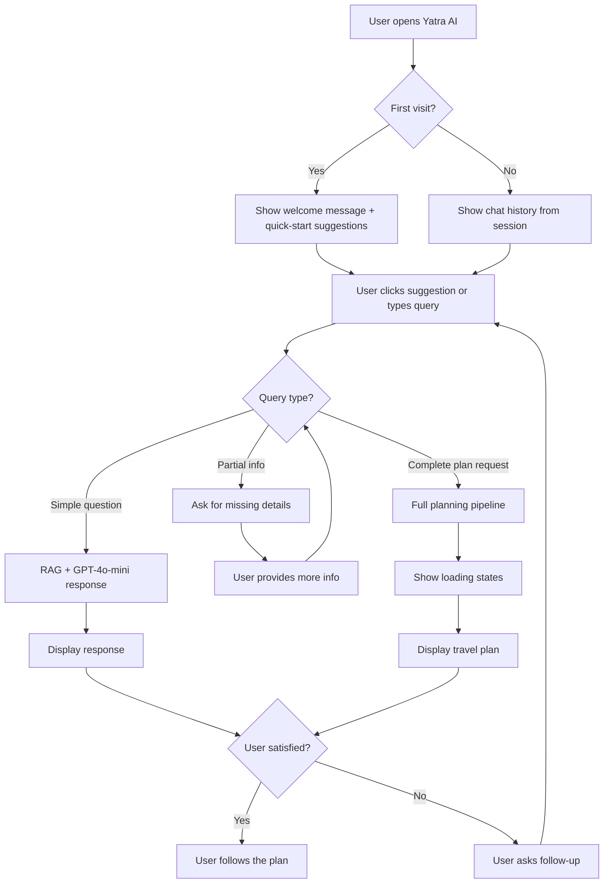
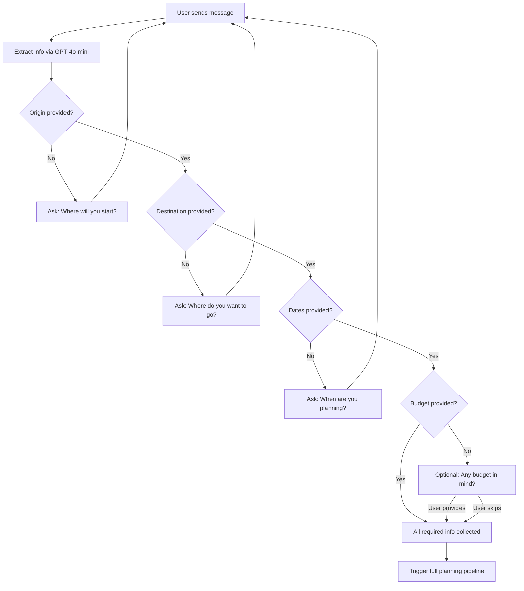
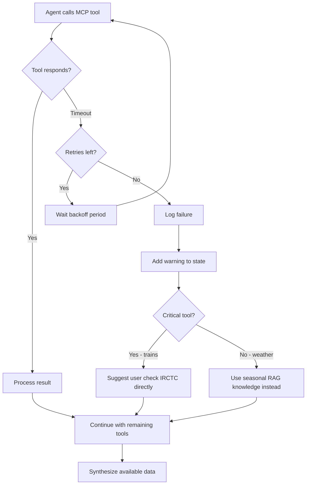

# 🏗️ Yatra AI — System Architecture

## Complete Technical Architecture Document

---

## 1. High-Level Architecture Overview

```
┌─────────────────────────────────────────────────────────────────┐
│                        STREAMLIT UI (app.py)                     │
│  ┌──────────┐  ┌───────────┐  ┌──────────┐  ┌───────────────┐  │
│  │ Chat Box │  │  Sidebar   │  │ Loading  │  │ Quick-Start   │  │
│  │          │  │ • KB Mgmt  │  │  States  │  │  Suggestions  │  │
│  │          │  │ • Config   │  │          │  │               │  │
│  │          │  │ • Tools    │  │          │  │               │  │
│  └────┬─────┘  └───────────┘  └──────────┘  └───────────────┘  │
│       │ user message                                             │
└───────┼──────────────────────────────────────────────────────────┘
        │
        ▼
┌───────────────────────────────────────────────────────────────────┐
│          LANGGRAPH STATEGRAPH WORKFLOW ORCHESTRATION               │
│                                                                   │
│  ┌────────────────┐    ┌─────────────────┐                        │
│  │ extract_info   │───▶│ pre_analyze_node│                        │
│  │ (GPT-4o-mini)  │    │ (Complexity &   │                        │
│  └────────────────┘    │  Mode Router)   │                        │
│                        └────────┬────────┘                        │
│                                 │ conditional edge                │
│         ┌───────────────────────┴───────────────────────┐          │
│         ▼                                               ▼          │
│  ┌───────────────┐                             ┌────────────────┐ │
│  │ simple_query_ │                             │ gemini_strategy│ │
│  │ node (RAG +   │                             │ node (Deep     │ │
│  │ Places fast)  │                             │ Route Planning)│ │
│  └──────┬────────┘                             └────────┬───────┘ │
│         │                                               │         │
│         │         ┌─────────────────────────────────────┘         │
│         │         ▼                                               │
│         │  ┌───────────────────────────────────────────────────┐  │
│         │  │ LANGCHAIN ReAct AGENT EXECUTION NODE              │  │
│         │  │ • Executes sub-goals and query legs               │  │
│         │  │ • Autonomous tool selection via LangChain Tools  │  │
│         │  └──────────────────────┬────────────────────────────┘  │
│         │                         │                               │
│         │                         ▼                               │
│         │  ┌───────────────────────────────────────────────────┐  │
│         │  │ critique_validator_node (LangGraph Cyclic Edge)   │  │
│         │  │ Checks budget limits, transit gaps, constraints   │  │
│         │  └──────────┬─────────────────────────┬──────────────┘  │
│         │             │ needs re-plan           │ pass            │
│         │             └───────────┐             │                 │
│         │    (max 2 iterations)   ▼             ▼                 │
│         │                     [Loop Back]  ┌───────────────────┐  │
│         │                                  │ synthesizer_node  │  │
│         │                                  │ (Gemini/GPT-4o)   │  │
│         │                                  └─────────┬─────────┘  │
│         └────────────────────────────────────────────┼────────────┘
│                                                      ▼
│                                     Streamlit Streaming Response
└──────────────────────────────────────────────────────┬────────────┘
                                                       │
                                                       ▼
                      ┌─────────────────────────────────────────────────┐
                      │    TOOL EXECUTION LAYER (LangChain MCP Tools)   │
                      │                                                 │
                      │  ┌──────────┐ ┌──────────┐ ┌──────────┐         │
                      │  │  IRCTC   │ │  Google  │ │ Weather  │         │
                      │  │  Trains  │ │   Maps   │ │   API    │         │
                      │  └────┬─────┘ └────┬─────┘ └────┬─────┘         │
                      │       │            │            │               │
                      │  ┌────┴─────┐ ┌────┴─────┐ ┌────┴─────────────┐ │
                      │  │ Flights  │ │ Intercity│ │   ChromaDB       │ │
                      │  │ (Amadeus)│ │  Buses   │ │  RAG Search      │ │
                      │  └──────────┘ └──────────┘ └──────────────────┘ │
                      └─────────────────────────────────────────────────┘
```

---

## 2. Technology Stack — Complete Breakdown

### 2.1 Backend

| Component | Technology | Version | Purpose | Alternatives Considered |
|---|---|---|---|---|
| **Language** | Python | ≥ 3.11 | Core language | — |
| **Workflow Orchestrator** | LangGraph | ≥ 0.2.0 | StateGraph multi-actor workflow, state persistence, conditional edges, validation loops | CrewAI, AutoGen (less granular state control) |
| **Agent Framework** | LangChain | ≥ 0.3.0 | ReAct Agent loop, tool wrappers over MCP SSE, prompts, RAG retrieval | Custom agent loop (higher maintenance) |
| **Primary LLM** | GPT-4o-mini (OpenAI) | Latest | Fast extraction, tool-calling, synthesis | Gemini Flash (good alt), Claude Haiku (limited tool-calling) |
| **Reasoning LLM** | Gemini 1.5 Pro (Google AI) | Latest | Complex reasoning, route optimization | DeepSeek R1 (original; less accessible in India), GPT-4o (more expensive) |
| **Embeddings** | OpenAI text-embedding-3-small | Latest | Vector embeddings for RAG | Cohere embed-v3 (good), sentence-transformers (free but slower) |
| **Vector DB** | ChromaDB | ≥ 0.5.0 | Local vector storage | Pinecone (cloud, paid), FAISS (no persistence OOTB), Weaviate (heavy) |
| **MCP Protocol** | mcp (Python SDK) | ≥ 1.0.0 | External tool connectivity | REST APIs (no protocol standardization), gRPC (overkill) |
| **Config** | python-dotenv | ≥ 1.0.0 | Environment variable management | pydantic-settings, dynaconf |
| **HTTP** | httpx | ≥ 0.27.0 | Async HTTP for MCP + APIs | aiohttp (heavier), requests (sync only) |
| **Validation** | Pydantic | ≥ 2.0.0 | Data validation and serialization | dataclasses (less validation), attrs |
| **Date Handling** | python-dateutil | ≥ 2.9.0 | Relative date parsing | dateparser (heavier), arrow |
| **PDF Processing** | pypdf | ≥ 4.0.0 | PDF document ingestion for RAG | PyMuPDF (faster but C deps), pdfplumber |

### 2.2 Frontend

| Component | Technology | Version | Purpose |
|---|---|---|---|
| **UI Framework** | Streamlit | ≥ 1.38.0 | Chat interface, sidebar, file upload |
| **Chat UI** | `st.chat_message` + `st.chat_input` | Built-in | Conversational interface |
| **File Upload** | `st.file_uploader` | Built-in | Knowledge base document upload |
| **Progress** | `st.status` + `st.spinner` | Built-in | Loading state indicators |
| **Config Widgets** | `st.slider`, `st.toggle`, `st.selectbox` | Built-in | User-configurable settings |

### 2.3 External APIs / MCP Servers

| Server | Data Source | API Provider | Auth Method | Rate Limit | Cost |
|---|---|---|---|---|---|
| **IRCTC Train** | Indian Railways timetable + fares | Custom MCP wrapper over IRCTC/RailwayAPI | API Key or public | ~100 req/day (free tier) | Free / ₹500/mo (paid) |
| **Google Maps** | Directions, Places, Hotels, Geocoding | Google Maps Platform | API Key | 40,000 req/mo (free) | Free tier; $5/1000 after |
| **Weather** | Forecasts, alerts | OpenWeatherMap | API Key | 60 req/min (free) | Free tier; $40/mo (paid) |
| **Flights** | Flight schedules + fares | Amadeus for Developers | OAuth 2.0 | 500 req/mo (free) | Free tier; $0.01/req (paid) |
| **Buses** | Bus schedules + fares | RedBus Unofficial / Custom | API Key | Varies | Free (unofficial) |

### 2.4 Infrastructure

| Component | Technology | Purpose |
|---|---|---|
| **Runtime** | Local Python process | Single-user deployment |
| **Container** | Docker (optional) | Reproducible deployment |
| **Hosting** | Streamlit Cloud / Railway / Render | Cloud deployment options |
| **Version Control** | Git + GitHub | Source code management |
| **CI/CD** | GitHub Actions (optional) | Automated testing |

---

## 3. Data Flow — Detailed Sequence

### 3.1 Simple Query Flow



### 3.2 Full Planning Query Flow



### 3.3 Complex Multi-City Flow (LangGraph + Gemini Strategy)



---

## 4. Component Architecture — Deep Dive

### 4.1 `app.py` — Streamlit Entry Point

**Responsibilities:**
- Initialize Streamlit page config (title, icon, layout)
- Load environment variables from `.env`
- Initialize session state (conversation history, travel state, MCP connections)
- Render chat interface (message history + input)
- Render sidebar (KB management, config, tools)
- On user message:
  1. Add to message history
  2. Call `extract_info()` → update state
  3. Call `pre_analyze_query()` → determine mode
  4. If simple → run simple query pipeline
  5. If full planning → run agent pipeline (GPT-4o-mini or Gemini-led)
  6. Display response with streaming
- Handle file uploads to RAG

**Key State Variables (`st.session_state`):**
```python
st.session_state.messages: list[dict]          # Chat history [{role, content}]
st.session_state.travel_state: TravelPlanState  # Extracted travel parameters
st.session_state.mcp_manager: MCPToolManager   # MCP connection manager
st.session_state.rag_tool: TravelRAGTool       # RAG search tool
st.session_state.graph: CompiledStateGraph     # Compiled LangGraph workflow
st.session_state.agent: AgentExecutor          # LangChain ReAct agent for tool execution
```

### 4.2 `yatra_agent/config/settings.py` — Global Configuration

```python
# Model Configuration
PRIMARY_MODEL = "gpt-4o-mini"
PRIMARY_MODEL_TEMPERATURE = 0.7
PRIMARY_MODEL_MAX_TOKENS = 4096

REASONING_MODEL = "gemini-1.5-pro"
REASONING_MODEL_TEMPERATURE = 0.3
REASONING_MODEL_MAX_TOKENS = 8192

EMBEDDING_MODEL = "text-embedding-3-small"
EMBEDDING_DIMENSIONS = 1536

# RAG Configuration
RAG_CHUNK_SIZE = 500
RAG_CHUNK_OVERLAP = 50
RAG_TOP_K = 5
CHROMA_PERSIST_DIR = "./data/travel_vectordb"
TRAVEL_DOCS_DIR = "./data/travel_docs"

# MCP Configuration
MCP_CONFIG_PATH = "yatra_agent/config/servers_config.json"
IRCTC_TIMEOUT = 120  # seconds
DEFAULT_TIMEOUT = 30  # seconds
MAX_RETRIES = 2
RETRY_BACKOFF = [1, 3]  # seconds

# Agent Configuration
MAX_AGENT_ITERATIONS = 15
AGENT_EARLY_STOP = "generate"

# Indian-Specific Constants
DEFAULT_CURRENCY = "INR"
CURRENCY_SYMBOL = "₹"
TIMEZONE = "Asia/Kolkata"
DATE_FORMAT = "%d-%m-%Y"
PETROL_PRICE_PER_LITER = 100  # INR
DIESEL_PRICE_PER_LITER = 95   # INR
AVG_CAR_MILEAGE_KM_PER_LITER = 15
NON_HIGHWAY_TIME_MULTIPLIER = 1.3

# Budget Thresholds (per night)
LUXURY_BUDGET_THRESHOLD = 3000
MID_BUDGET_THRESHOLD = 1500
ECONOMY_BUDGET_THRESHOLD = 800

# Deep Analysis Triggers
TIGHT_BUDGET_PER_PERSON_PER_DAY = 500  # INR
MULTI_CITY_THRESHOLD = 3  # destinations
LONG_DISTANCE_FLIGHT_THRESHOLD = 500  # km
LONG_TRAIN_DURATION_THRESHOLD = 12  # hours
```

### 4.3 `yatra_agent/config/prompts.py` — All LLM Prompts

**Prompt inventory (each is a multi-paragraph template):**

| Prompt Name | Used By | Purpose | Approx Length |
|---|---|---|---|
| `INFORMATION_EXTRACTION_PROMPT` | GPT-4o-mini | Extract structured fields from natural language | ~800 tokens |
| `PLANNER_SYSTEM_PROMPT` | GPT-4o-mini Agent | System prompt for the ReAct planning agent | ~1200 tokens |
| `SYNTHESIZER_PROMPT_TEMPLATE` | GPT-4o-mini | Generate final Markdown travel plan from data | ~1500 tokens |
| `GEMINI_STRATEGY_PROMPT` | Gemini 1.5 Pro | Decompose complex query into query_plan | ~1000 tokens |
| `GEMINI_OPTIMIZATION_PROMPT` | Gemini 1.5 Pro | Second-pass optimization of gathered data | ~800 tokens |
| `SIMPLE_QUERY_PROMPT` | GPT-4o-mini | Respond to simple destination questions | ~400 tokens |
| `MISSING_INFO_PROMPT` | GPT-4o-mini | Ask user for missing required fields | ~300 tokens |
| `PRE_ANALYSIS_PROMPT` | GPT-4o-mini | Classify query complexity | ~500 tokens |

### 4.4 `yatra_agent/graph/state.py` — State Types

```python
from typing import TypedDict, Optional, Annotated
from langgraph.graph.message import add_messages

class TravelPlanState(TypedDict):
    # Conversation history with LangGraph reducer
    messages: Annotated[list, add_messages]
    
    # Extracted travel parameters
    origin: str
    destinations: list[str]
    departure_date: str
    return_date: str
    num_days: int
    budget: float
    budget_currency: str
    num_travelers: int
    traveler_details: str
    preferences: list[str]
    optimization_goal: str
    travel_mode_pref: str
    
    # Workflow routing & analysis
    query_type: str                 # "simple" | "full_planning"
    needs_deep_analysis: bool
    complexity_reason: str
    
    # Real-time tool results (via LangChain MCP tools)
    train_data: dict
    driving_data: dict
    hotel_data: dict
    weather_data: dict
    flight_data: dict
    bus_data: dict
    rag_results: list
    
    # Gemini deep planning & optimization
    query_plan: list               # Decomposed step-by-step legs
    gemini_analysis: str           # Optimization insights
    
    # Validation & Critique Loop
    validation_passed: bool
    validation_feedback: str
    iteration_count: int           # Guardrail against infinite loops (max 2)
    
    # Final output
    final_plan: str
```

### 4.5 `yatra_agent/graph/workflow.py` — LangGraph Workflow Definition

```python
from langgraph.graph import StateGraph, END
from langgraph.checkpoint.memory import MemorySaver
from yatra_agent.graph.state import TravelPlanState
from yatra_agent.graph import nodes

def build_travel_workflow():
    """Builds and compiles the hybrid LangGraph + LangChain state graph."""
    workflow = StateGraph(TravelPlanState)
    
    # 1. Register processing nodes
    workflow.add_node("extract_info", nodes.extract_info_node)
    workflow.add_node("pre_analyze", nodes.pre_analyze_node)
    workflow.add_node("simple_query", nodes.simple_query_node)
    workflow.add_node("gemini_strategy", nodes.gemini_strategy_node)
    workflow.add_node("react_agent_execution", nodes.react_agent_execution_node)
    workflow.add_node("critique_validator", nodes.critique_validator_node)
    workflow.add_node("synthesizer", nodes.synthesizer_node)
    
    # 2. Define standard transitions
    workflow.set_entry_point("extract_info")
    workflow.add_edge("extract_info", "pre_analyze")
    
    # 3. Conditional routing based on complexity
    def route_by_complexity(state: TravelPlanState) -> str:
        if state["query_type"] == "simple":
            return "simple_query"
        if state.get("needs_deep_analysis", False):
            return "gemini_strategy"
        return "react_agent_execution"
        
    workflow.add_conditional_edges(
        "pre_analyze",
        route_by_complexity,
        {
            "simple_query": "simple_query",
            "gemini_strategy": "gemini_strategy",
            "react_agent_execution": "react_agent_execution"
        }
    )
    
    workflow.add_edge("gemini_strategy", "react_agent_execution")
    workflow.add_edge("react_agent_execution", "critique_validator")
    
    # 4. Conditional validation loop (cyclic edge with max iteration guardrail)
    def route_validation(state: TravelPlanState) -> str:
        if state.get("validation_passed", True) or state.get("iteration_count", 0) >= 2:
            return "synthesizer"
        return "react_agent_execution"  # Loop back for refinement
        
    workflow.add_conditional_edges(
        "critique_validator",
        route_validation,
        {
            "synthesizer": "synthesizer",
            "react_agent_execution": "react_agent_execution"
        }
    )
    
    workflow.add_edge("simple_query", END)
    workflow.add_edge("synthesizer", END)
    
    # Compile with in-memory checkpointing for conversation persistence
    memory = MemorySaver()
    return workflow.compile(checkpointer=memory)
```

### 4.6 `yatra_agent/graph/nodes.py` — Processing Nodes

**Node inventory:**

| Node | Input | Output | Tech / Model Used | Description |
|---|---|---|---|---|
| `extract_info_node` | User message + state | Extracted fields in state | LangChain + GPT-4o-mini | Parameter extraction |
| `pre_analyze_node` | State | `query_type`, `needs_deep_analysis` | Rules + GPT-4o-mini | Graph routing evaluation |
| `simple_query_node` | State | Formatted answer | LangChain RAG + Places | Direct Q&A response |
| `gemini_strategy_node` | Full state | `query_plan` | Gemini 1.5 Pro | Multi-city & budget decomposition |
| `react_agent_execution_node`| State, query_plan | Tool results populated | LangChain ReAct Agent + MCP | Executes MCP tools (IRCTC, Maps, Weather, Flights, Buses) |
| `critique_validator_node` | State | `validation_passed`, feedback | Python rule engine | Constraint & feasibility check loop |
| `synthesizer_node` | Full state | `final_plan` (Markdown) | LangChain + GPT-4o-mini / Gemini | Final itinerary compilation |

### 4.7 `yatra_agent/tools/mcp_tools.py` — MCP Tool Manager

**Class structure:**
```python
class MCPToolManager:
    """Manages connections to all MCP servers with retry and timeout logic."""
    
    def __init__(self, config_path: str):
        self.config = load_config(config_path)
        self.connections: dict[str, MCPConnection] = {}
        self.tools: dict[str, ToolDefinition] = {}
    
    async def connect_all(self) -> list[str]:
        """Connect to all configured MCP servers. Returns list of available tool names."""
        for server in self.config["mcp_servers"]:
            try:
                conn = await self._connect_sse(server["url"], timeout=30)
                tools = await conn.list_tools()
                self.connections[server["name"]] = conn
                for tool in tools:
                    self.tools[f"{server['name']}.{tool.name}"] = tool
            except Exception as e:
                logger.warning(f"Failed to connect to {server['name']}: {e}")
        return list(self.tools.keys())
    
    async def call_tool(self, server: str, tool: str, params: dict) -> dict:
        """Call a tool on a specific MCP server with retry logic."""
        timeout = IRCTC_TIMEOUT if "irctc" in server.lower() else DEFAULT_TIMEOUT
        
        for attempt in range(MAX_RETRIES + 1):
            try:
                result = await asyncio.wait_for(
                    self.connections[server].call_tool(tool, params),
                    timeout=timeout
                )
                return result
            except asyncio.TimeoutError:
                logger.warning(f"Timeout calling {server}.{tool} (attempt {attempt+1})")
                if attempt < MAX_RETRIES:
                    await asyncio.sleep(RETRY_BACKOFF[attempt])
            except Exception as e:
                logger.error(f"Error calling {server}.{tool}: {e}")
                if attempt < MAX_RETRIES:
                    await asyncio.sleep(RETRY_BACKOFF[attempt])
        
        return {"error": f"Failed after {MAX_RETRIES+1} attempts", "tool": tool}
    
    async def health_check(self) -> dict[str, dict]:
        """Check connectivity of all servers."""
        results = {}
        for name, conn in self.connections.items():
            try:
                tools = await conn.list_tools()
                results[name] = {"status": "healthy", "tools": len(tools)}
            except:
                results[name] = {"status": "unhealthy", "tools": 0}
        return results
```

### 4.8 `yatra_agent/tools/rag_tool.py` — RAG Vector Search

**Class structure:**
```python
class TravelRAGTool:
    """Manages ChromaDB vector database for travel knowledge retrieval."""
    
    def __init__(self, persist_dir: str = CHROMA_PERSIST_DIR):
        self.client = chromadb.PersistentClient(path=persist_dir)
        self.collection = self.client.get_or_create_collection(
            name="travel_knowledge",
            metadata={"hnsw:space": "cosine"}
        )
        self.embeddings = OpenAIEmbeddings(model=EMBEDDING_MODEL)
        self.text_splitter = RecursiveCharacterTextSplitter(
            chunk_size=RAG_CHUNK_SIZE,
            chunk_overlap=RAG_CHUNK_OVERLAP,
            separators=["\n\n", "\n", ". ", " "]
        )
    
    def build_knowledge_base(self, data_dir: str, force_recreate: bool = False):
        """Import all documents from data_dir into ChromaDB."""
    
    def search(self, query: str, top_k: int = RAG_TOP_K) -> list[Document]:
        """Search for relevant documents using cosine similarity."""
    
    def get_stats(self) -> dict:
        """Return database statistics."""
    
    def delete_by_source(self, source: str):
        """Delete all chunks from a specific source file."""
```

### 4.9 `yatra_agent/tools/tool_registry.py` — Tool Definitions

```python
@dataclass
class ToolDefinition:
    name: str
    description: str
    parameters: dict          # JSON Schema
    tool_type: str            # "mcp" | "rag" | "llm" | "local"
    server_name: str          # MCP server name (if mcp type)
    mcp_tool_name: str        # Actual tool name on MCP server
    timeout: int = 30         # Timeout in seconds
    is_conditional: bool = False  # Only triggered under conditions

# All tool definitions
TOOL_DEFINITIONS = [
    ToolDefinition(
        name="search_trains",
        description="Search for trains between two Indian railway stations on a specific date. Returns train numbers, names, timings, classes, and fares.",
        parameters={...},
        tool_type="mcp",
        server_name="IRCTC Server",
        mcp_tool_name="search_trains",
        timeout=120
    ),
    ToolDefinition(
        name="get_driving_directions",
        description="Calculate driving route between two Indian cities. Returns distance in km, estimated time, fuel cost, and toll charges.",
        parameters={...},
        tool_type="mcp",
        server_name="Google Maps Server",
        mcp_tool_name="get_directions",
        timeout=30
    ),
    # ... all other tools
]
```

---

## 5. User Flow Diagrams

### 5.1 First-Time User Flow



### 5.2 Information Collection Flow



### 5.3 Error Recovery Flow



---

## 6. Database Schema

### 6.1 ChromaDB Collection: `travel_knowledge`

| Field | Type | Description |
|---|---|---|
| `id` | string (UUID) | `MD5(source:index:content[:100])` |
| `document` | string | Chunk text content |
| `metadata.source` | string | Source file path |
| `metadata.chunk_index` | int | Position in source document |
| `metadata.category` | string | "city_guide", "transport", "food", etc. |
| `metadata.region` | string | "north_india", "south_india", etc. |
| `metadata.created_at` | string | ISO timestamp |
| `embedding` | float[1536] | OpenAI text-embedding-3-small vector |

### 6.2 Session State (In-Memory)

No persistent database. All state lives in `st.session_state` during a Streamlit session.

| Key | Type | Lifetime |
|---|---|---|
| `messages` | list[dict] | Session |
| `travel_state` | TravelPlanState | Session |
| `mcp_manager` | MCPToolManager | Session |
| `rag_tool` | TravelRAGTool | Session |
| `graph` | CompiledStateGraph | Session |
| `agent` | AgentExecutor | Session |

---

## 7. API Integration Details

### 7.1 OpenAI API

**Endpoints Used:**
- `POST /v1/chat/completions` — GPT-4o-mini for extraction, planning, synthesis
- `POST /v1/embeddings` — text-embedding-3-small for RAG

**Authentication:** `Authorization: Bearer $OPENAI_API_KEY`

**Rate Limits (Tier 1):**
- 500 RPM (requests per minute)
- 200,000 TPM (tokens per minute)

**Cost Estimation:**
- GPT-4o-mini: $0.15/1M input tokens, $0.60/1M output tokens
- text-embedding-3-small: $0.02/1M tokens
- Per full planning query: ~$0.01-0.03

### 7.2 Google AI API (Gemini)

**Endpoints Used:**
- `POST /v1beta/models/gemini-1.5-pro:generateContent` — Complex reasoning

**Authentication:** `x-goog-api-key: $GOOGLE_API_KEY`

**Rate Limits (Free Tier):**
- 15 RPM
- 1M TPM
- 1500 RPD (requests per day)

**Cost Estimation:**
- Gemini 1.5 Pro: $1.25/1M input tokens, $5.00/1M output tokens
- Per complex query: ~$0.02-0.05

### 7.3 Google Maps Platform

**APIs Used:**
- Directions API — driving routes
- Places API (New) — hotel search, POI search
- Geocoding API — address → coordinates

**Authentication:** API Key (restricted to specific APIs + referrer)

**Free Tier:** $200/month credit (~40,000 requests)

### 7.4 OpenWeatherMap

**APIs Used:**
- 5-day/3-hour forecast — `GET /data/2.5/forecast`
- Current weather — `GET /data/2.5/weather`

**Authentication:** `appid` query parameter

**Free Tier:** 60 calls/minute, 1,000,000 calls/month

---

## 8. Security Architecture

```
┌──────────────────────────────┐
│         .env file            │
│  (gitignored, local only)    │
│                              │
│  OPENAI_API_KEY=sk-...       │
│  GOOGLE_API_KEY=AIza...      │
│  GMAPS_API_KEY=AIza...       │
│  WEATHER_API_KEY=...         │
│  IRCTC_API_KEY=...           │
│  AMADEUS_API_KEY=...         │
│  AMADEUS_API_SECRET=...      │
└──────────┬───────────────────┘
           │ loaded by python-dotenv
           ▼
┌──────────────────────────────┐
│     Application Runtime      │
│                              │
│  • Keys accessed via         │
│    os.getenv() only          │
│  • Never logged or printed   │
│  • Never sent to frontend    │
│  • Never included in         │
│    LLM prompts               │
└──────────────────────────────┘
```

**Security Measures:**
1. `.env` is in `.gitignore` — never committed
2. `.env.example` has placeholder values only
3. API keys are accessed via `os.getenv()` — never hardcoded
4. API keys are never sent to LLMs (they're used by MCP servers, not the Agent)
5. No user data is persisted to disk
6. No authentication on the Streamlit app (single-user deployment)
7. HTTPS for all external API calls
8. MCP connections use SSE over HTTPS

---

## 9. Deployment Architecture

### 9.1 Local Development

```
Developer Machine
├── Python 3.11+ virtualenv
├── Streamlit dev server (port 8501)
├── ChromaDB (local file storage)
├── .env (API keys)
└── Outbound HTTPS connections
    ├── → OpenAI API
    ├── → Google AI API
    ├── → Google Maps API
    ├── → MCP Servers (SSE)
    └── → Weather API
```

### 9.2 Docker Deployment

```dockerfile
FROM python:3.11-slim

WORKDIR /app

# Install dependencies
COPY requirements.txt .
RUN pip install --no-cache-dir -r requirements.txt

# Copy application
COPY . .

# Create data directories
RUN mkdir -p data/travel_docs data/travel_vectordb

# Expose Streamlit port
EXPOSE 8501

# Health check
HEALTHCHECK CMD curl --fail http://localhost:8501/_stcore/health

# Run
CMD ["streamlit", "run", "app.py", \
     "--server.address", "0.0.0.0", \
     "--server.port", "8501", \
     "--server.headless", "true"]
```

### 9.3 Cloud Deployment (Streamlit Cloud)

```
GitHub Repository
    │
    ▼
Streamlit Cloud
├── Auto-deploy from main branch
├── Secrets management (UI)
│   ├── OPENAI_API_KEY
│   ├── GOOGLE_API_KEY
│   └── ... (all API keys)
├── Ephemeral filesystem
│   └── ChromaDB rebuilt on each deploy
└── Public URL: https://yatra-ai.streamlit.app
```

---

## 10. Monitoring & Observability

### 10.1 Logging Strategy

```python
import logging

# Structured logging
logger = logging.getLogger("yatra_ai")
logger.setLevel(logging.INFO)

# Log format
formatter = logging.Formatter(
    "%(asctime)s | %(levelname)s | %(name)s | %(message)s"
)

# Key log events:
# INFO:  User query received, tool called, response generated
# WARN:  Tool timeout, retry triggered, fallback used
# ERROR: Tool failed after all retries, LLM error
# DEBUG: Full tool params and responses (dev only)
```

### 10.2 Cost Tracking

```python
# Track token usage per query
class CostTracker:
    def __init__(self):
        self.openai_input_tokens = 0
        self.openai_output_tokens = 0
        self.gemini_input_tokens = 0
        self.gemini_output_tokens = 0
        self.embedding_tokens = 0
    
    def estimate_cost_inr(self) -> float:
        """Estimate cost in INR for this query."""
        usd_cost = (
            self.openai_input_tokens / 1e6 * 0.15 +
            self.openai_output_tokens / 1e6 * 0.60 +
            self.gemini_input_tokens / 1e6 * 1.25 +
            self.gemini_output_tokens / 1e6 * 5.00 +
            self.embedding_tokens / 1e6 * 0.02
        )
        return usd_cost * 84  # USD to INR
```

### 10.3 LangSmith Integration (Optional)

```bash
# Enable in .env for debugging
LANGCHAIN_TRACING_V2=true
LANGCHAIN_API_KEY=ls-your-key
LANGCHAIN_PROJECT=yatra-ai
```

Provides:
- Full trace of every Agent step
- Tool call inputs/outputs
- Token counts per call
- Latency per step
- Error traces

---

## 11. Performance Characteristics

| Metric | Simple Query | Single-City Plan | Multi-City Plan |
|---|---|---|---|
| LLM calls | 1-2 | 3-5 | 6-10 |
| MCP tool calls | 0-1 | 4-7 | 10-20 |
| RAG searches | 1 | 1 | 1-3 |
| Total latency | 3-8s | 15-30s | 30-90s |
| Input tokens | ~500 | ~3,000 | ~8,000 |
| Output tokens | ~200 | ~1,500 | ~3,000 |
| Est. cost (INR) | ₹0.50 | ₹2-3 | ₹5-8 |
