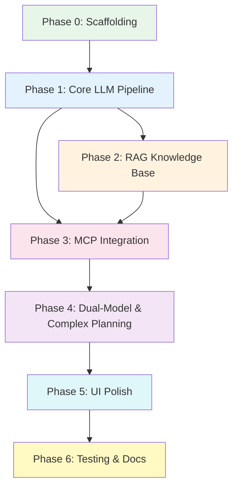

# 🗺️ Yatra AI — Development Plan

## Phased Build Strategy

> This plan divides the entire project into **6 phases**, each with clear deliverables, estimated timelines, and dependencies. Each phase is independently testable.

---

## Phase Overview

| Phase | Name | Duration | Deliverable |
|---|---|---|---|
| **Phase 0** | Project Scaffolding & Environment | 1 day | Repo structure, virtualenv, configs, hello-world Streamlit |
| **Phase 1** | Core LLM Pipeline (Single Model) | 3-4 days | Basic chat with GPT-4o-mini, information extraction, simple responses |
| **Phase 2** | RAG Knowledge Base | 2-3 days | ChromaDB setup, document ingestion, search-powered answers |
| **Phase 3** | MCP Server & Agent Integration | 5-7 days | All 5 MCP servers connected, LangChain Agent + LangGraph workflow work end-to-end |
| **Phase 4** | Dual-Model & Complex Planning | 3-4 days | Gemini 1.5 Pro integration, pre-analysis routing, multi-city support |
| **Phase 5** | Streamlit UI Polish & UX | 2-3 days | Sidebar, loading states, error messages, knowledge base management UI |
| **Phase 6** | Testing, Hardening & Documentation | 2-3 days | Edge cases, error recovery, health checks, README, deployment guide |

**Total Estimated Duration: 18-25 days** (solo developer, part-time ~4-6 hours/day)

---

## Phase 0: Project Scaffolding & Environment Setup

**Duration:** 1 day
**Goal:** Get a clean, runnable project skeleton with all dependencies installed.

### Tasks

#### 0.1 Repository Initialization
- [ ] Create GitHub repository `yatra-ai`
- [ ] Initialize with `.gitignore` (Python template + custom exclusions)
- [ ] Add MIT `LICENSE`
- [ ] Create initial `README.md` with project title and one-line description

#### 0.2 Directory Structure Creation
```
yatra-ai/
├── yatra_agent/                    # Main Python package
│   ├── __init__.py
│   ├── config/
│   │   ├── __init__.py
│   │   ├── prompts.py              # All LLM prompt templates
│   │   ├── settings.py             # Global configuration constants
│   │   └── servers_config.json     # MCP server URLs
│   ├── core/
│   │   ├── __init__.py
│   │   └── agent_executor.py       # LangChain Agent setup
│   ├── graph/
│   │   ├── __init__.py
│   │   ├── state.py                # TravelPlanState TypedDict
│   │   ├── workflow.py             # LangGraph StateGraph definition & compiled app
│   │   └── nodes.py                # All processing nodes
│   ├── tools/
│   │   ├── __init__.py
│   │   ├── rag_tool.py             # RAG vector search tool
│   │   ├── mcp_tools.py            # MCP tool manager with retry logic
│   │   ├── gemini_tool.py          # Gemini 1.5 Pro wrapper
│   │   └── tool_registry.py        # All tool definitions
│   └── utils/
│       ├── __init__.py
│       ├── date_parser.py          # Relative date resolution (IST)
│       └── city_resolver.py        # City name alias mapping
├── data/
│   ├── travel_docs/                # Raw travel guide documents
│   └── travel_vectordb/            # ChromaDB persistence directory
├── app.py                          # Streamlit UI entry point
├── check_mcp_health.py             # MCP health check script
├── requirements.txt
├── setup.py
├── .env.example                    # Template for environment variables
├── .env                            # Actual secrets (gitignored)
├── .gitignore
├── LICENSE
└── README.md
```

#### 0.3 Virtual Environment & Dependencies
- [ ] Create virtualenv: `python -m venv .venv`
- [ ] Create `requirements.txt`:
  ```
  # Core framework
  langchain>=0.3.0
  langchain-openai>=0.2.0
  langchain-google-genai>=2.0.0
  langchain-community>=0.3.0
  
  # UI
  streamlit>=1.38.0
  
  # Vector database
  chromadb>=0.5.0
  
  # Document processing
  pypdf>=4.0.0
  python-docx>=1.0.0
  
  # MCP protocol
  mcp>=1.0.0
  
  # Embeddings
  openai>=1.40.0
  
  # Utilities
  python-dotenv>=1.0.0
  httpx>=0.27.0
  pydantic>=2.0.0
  
  # Date handling
  python-dateutil>=2.9.0
  ```
- [ ] Install: `pip install -r requirements.txt`
- [ ] Create `setup.py` for editable install: `pip install -e .`

#### 0.4 Environment Configuration
- [ ] Create `.env.example`:
  ```bash
  # Required API Keys
  OPENAI_API_KEY=sk-your-openai-key
  GOOGLE_API_KEY=your-google-ai-key
  
  # Optional: LangChain tracing
  LANGCHAIN_TRACING_V2=false
  
  # Paths (defaults)
  MCP_CONFIG_PATH=yatra_agent/config/servers_config.json
  CHROMA_PERSIST_DIR=./data/travel_vectordb
  ```
- [ ] Create `.env` from `.env.example` with real keys

#### 0.5 Hello World Streamlit App
- [ ] Create minimal `app.py`:
  ```python
  import streamlit as st
  st.set_page_config(page_title="Yatra AI", page_icon="🌍")
  st.title("🌍 Yatra AI — Intelligent Travel Planner")
  st.write("System is loading...")
  ```
- [ ] Verify: `streamlit run app.py` opens in browser

### Definition of Done (Phase 0)
- ✅ `streamlit run app.py` shows the title page
- ✅ All dependencies install without errors
- ✅ Directory structure matches the specification
- ✅ `.env` loaded successfully (test with `python -c "from dotenv import load_dotenv; load_dotenv(); import os; print(os.getenv('OPENAI_API_KEY')[:10])"`)

---

## Phase 1: Core LLM Pipeline (Single Model)

**Duration:** 3-4 days
**Goal:** Users can chat with the AI, which extracts travel information and responds intelligently (no external tools yet).

### Tasks

#### 1.1 State Definition (`state.py`)
- [ ] Define `TravelPlanState` TypedDict:
  ```python
  class TravelPlanState(TypedDict):
      messages: list              # Chat history
      origin: str                 # "Delhi"
      destinations: list[str]    # ["Jaipur"]
      departure_date: str        # "2026-12-15"
      return_date: str           # "2026-12-17"
      num_days: int              # 3
      budget: float              # 8000.0
      budget_currency: str       # "INR"
      num_travelers: int         # 2
      traveler_details: str      # "2 adults"
      preferences: list[str]    # ["vegetarian"]
      optimization_goal: str     # "cheapest"
      travel_mode_pref: str      # "train"
      query_type: str            # "simple" | "full_planning"
      needs_deep_analysis: bool  # False
      complexity_reason: str     # ""
      train_data: dict           # {}
      driving_data: dict         # {}
      hotel_data: dict           # {}
      weather_data: dict         # {}
      flight_data: dict          # {}
      bus_data: dict             # {}
      rag_results: list          # []
      query_plan: list           # []
      validation_passed: bool    # True
      validation_feedback: str   # ""
      iteration_count: int       # 0
      final_plan: str            # ""
  ```

#### 1.2 Prompt Templates (`prompts.py`)
- [ ] Write `INFORMATION_EXTRACTION_PROMPT` — system prompt for GPT-4o-mini to extract travel parameters from natural language
- [ ] Write `PLANNER_SYSTEM_PROMPT` — system prompt for the planning agent describing all available tools and their usage patterns
- [ ] Write `SYNTHESIZER_PROMPT_TEMPLATE` — template for generating the final travel plan from gathered data
- [ ] Write `GEMINI_STRATEGY_PROMPT` — prompt for Gemini 1.5 Pro to decompose complex queries into a query_plan
- [ ] Write `SIMPLE_QUERY_PROMPT` — lightweight prompt for simple destination queries
- [ ] Write `MISSING_INFO_PROMPT` — prompt to ask users for missing required fields

#### 1.3 Information Extraction Node (`nodes.py`)
- [ ] Implement `extract_info(user_message: str, state: TravelPlanState) -> TravelPlanState`
- [ ] Use GPT-4o-mini with structured output (JSON mode) to extract fields
- [ ] Handle relative dates: "tomorrow" → actual date in IST
- [ ] Handle Hindi/Hinglish input
- [ ] Handle city name aliases via `city_resolver.py`
- [ ] Detect query type: simple vs full_planning
- [ ] Return updated state with extracted fields

#### 1.4 City Name Resolver (`city_resolver.py`)
- [ ] Create mapping dictionary:
  ```python
  CITY_ALIASES = {
      "bombay": "Mumbai", "mumbai": "Mumbai",
      "bangalore": "Bengaluru", "bengaluru": "Bengaluru",
      "calcutta": "Kolkata", "kolkata": "Kolkata",
      "madras": "Chennai", "chennai": "Chennai",
      "trivandrum": "Thiruvananthapuram",
      "poona": "Pune", "pune": "Pune",
      "benares": "Varanasi", "banaras": "Varanasi", "kashi": "Varanasi",
      "cochin": "Kochi", "kochi": "Kochi",
      "pondicherry": "Puducherry",
      "shimla": "Shimla", "simla": "Shimla",
      "ooty": "Udhagamandalam",
      "gurgaon": "Gurugram",
      # ... 50+ more entries
  }
  ```
- [ ] Implement `resolve_city(name: str) -> str` with fuzzy matching

#### 1.5 Date Parser (`date_parser.py`)
- [ ] Implement `parse_travel_date(text: str) -> str` (returns YYYY-MM-DD)
- [ ] Handle: "tomorrow", "day after tomorrow", "next Monday", "next week", "Dec 15", "15 December", "15/12/2026", "15-12-2026"
- [ ] All dates in IST (UTC+5:30)
- [ ] Handle Hindi: "kal", "parso", "agle hafte"

#### 1.6 Basic Chat Interface (`app.py`)
- [ ] Streamlit chat interface with `st.chat_message` and `st.chat_input`
- [ ] Session state management for conversation history
- [ ] Display extracted parameters in sidebar (debug view)
- [ ] "Clear Chat" button
- [ ] Basic message routing:
  - User sends message → extract info → if enough info, plan; else, ask for more

#### 1.7 Simple Response Generation
- [ ] For simple queries (no full plan needed), GPT-4o-mini generates a conversational response
- [ ] For incomplete planning requests, system asks for missing fields
- [ ] For complete planning requests, placeholder: "All information collected! Planning pipeline coming in Phase 3."

### Definition of Done (Phase 1)
- ✅ User can chat naturally, and the system extracts origin/destination/dates/budget
- ✅ System asks for missing info: "Where are you starting from?"
- ✅ Relative dates work: "tomorrow" → correct date
- ✅ City aliases work: "Bombay" → "Mumbai"
- ✅ Sidebar shows extracted state (debug)
- ✅ Conversation persists across messages (multi-turn)
- ✅ "Clear Chat" works

---

## Phase 2: RAG Knowledge Base

**Duration:** 2-3 days
**Goal:** System can answer questions about Indian destinations using a vector knowledge base.

### Tasks

#### 2.1 RAG Tool Implementation (`rag_tool.py`)
- [ ] Initialize ChromaDB client with persistent storage
- [ ] Configure OpenAI `text-embedding-3-small` embeddings
- [ ] Implement `TravelRAGTool` class:
  ```python
  class TravelRAGTool:
      def __init__(self, persist_dir: str = "./data/travel_vectordb")
      def build_knowledge_base(self, data_dir: str, force_recreate: bool = False)
      def search(self, query: str, top_k: int = 5) -> list[Document]
      def get_stats(self) -> dict
      def delete_by_source(self, source: str)
  ```
- [ ] Document loaders for `.txt`, `.md`, `.pdf`, `.csv`
- [ ] Chunking with `RecursiveCharacterTextSplitter(chunk_size=500, chunk_overlap=50)`
- [ ] UUID generation: `MD5(f"{source}:{index}:{content[:100]}")`
- [ ] Deduplication on import

#### 2.2 Seed Knowledge Base
- [ ] Create 10-15 seed travel guide documents covering:
  - Top 10 Indian destinations (Jaipur, Goa, Kerala, Varanasi, Manali, Udaipur, Rishikesh, Hampi, Andaman, Darjeeling)
  - Budget travel tips for India
  - Indian railway classes explained
  - Monsoon travel guide
  - Temple etiquette guide
  - Street food safety tips
- [ ] Each document: 500-2000 words, markdown format
- [ ] Import into ChromaDB

#### 2.3 RAG Integration into Chat Pipeline
- [ ] For **simple queries**: search RAG → inject top results into GPT-4o-mini context → generate enriched answer
- [ ] For **full planning**: search RAG for destination guide → add to state as `rag_results` → use in synthesis
- [ ] Show RAG source attribution in responses: "Based on our travel guide for Jaipur..."

#### 2.4 Knowledge Base Management UI (Sidebar)
- [ ] File upload widget in Streamlit sidebar
- [ ] Show upload progress
- [ ] Display knowledge base stats (total docs, sources)
- [ ] Refresh/rebuild button

### Definition of Done (Phase 2)
- ✅ "What are the best places in Jaipur?" returns a rich, knowledge-enhanced answer
- ✅ ChromaDB persists across app restarts
- ✅ Upload a new `.txt` file via sidebar → it's searchable immediately
- ✅ Stats show correct document count
- ✅ RAG results are attributed in responses

---

## Phase 3: MCP Server & LangChain / LangGraph Integration

**Duration:** 5-7 days (5 MCP servers + LangChain ReAct tools + LangGraph compilation)
**Goal:** LangGraph coordinates the workflow, while the LangChain ReAct Agent calls external tools (trains, maps, weather, flights, buses).

### Tasks

#### 3.1 MCP Tool Manager (`mcp_tools.py`)
- [ ] Implement `MCPToolManager` class:
  ```python
  class MCPToolManager:
      def __init__(self, config_path: str)
      async def connect_all(self) -> list[str]          # Returns tool names
      async def call_tool(self, server: str, tool: str, params: dict) -> dict
      async def disconnect_all(self)
      def get_available_tools(self) -> list[ToolDefinition]
      async def health_check(self) -> dict[str, bool]
  ```
- [ ] SSE connection with keep-alive
- [ ] Auto-retry: 2 retries on failure, exponential backoff (1s, 3s)
- [ ] Timeout: 120s for IRCTC, 30s for others
- [ ] Connection pooling (reuse SSE connections across calls)
- [ ] Error isolation: one server failure doesn't affect others

#### 3.2 Tool Registry & LangChain Adapter (`tool_registry.py`)
- [ ] Define all tool schemas as `ToolDefinition` objects
- [ ] Convert MCP tools into LangChain `StructuredTool` / `BaseTool` instances
- [ ] Register tools for the LangChain Agent with typing and descriptions

#### 3.3 IRCTC Train Server Integration
- [ ] Connect to IRCTC MCP server
- [ ] Implement station code resolution: city → station code(s)
  - Build station code cache: `{"Delhi": ["NDLS", "DLI", "DEE", "ANVT"], "Mumbai": ["CSTM", "BCT", "LTT"], ...}`
- [ ] Implement train search: date + stations → train list
- [ ] Parse response: extract train number, name, departure, arrival, duration, classes, fares
- [ ] Handle IRCTC timeouts gracefully (120s timeout, 2 retries)
- [ ] Test with real queries: Delhi→Jaipur, Mumbai→Pune, Bangalore→Chennai

#### 3.4 Google Maps Server Integration
- [ ] Connect to Google Maps MCP server
- [ ] Implement driving directions: origin + destination → distance, time, route, tolls
  - Calculate fuel cost: `distance_km / 15 * 100` (petrol) or `distance_km / 18 * 95` (diesel)
  - Add 1.3x time multiplier for non-NH routes
- [ ] Implement hotel search: location + keyword + price range → hotel list
  - Budget mapping: price → keyword ("5-star", "OYO", "hostel", "dharamshala")
- [ ] Implement POI search: "tourist places in Jaipur" → list of attractions
- [ ] Test with real queries

#### 3.5 Weather Server Integration
- [ ] Connect to Weather MCP server (OpenWeatherMap or WeatherAPI based)
- [ ] Implement forecast: city + days → daily weather
- [ ] Add monsoon awareness: June-Sept flag
- [ ] Add fog awareness: Nov-Jan for North India
- [ ] Add heatwave awareness: April-June for most of India
- [ ] Test with real queries

#### 3.6 Flight Server Integration (Conditional)
- [ ] Connect to Flight MCP server (Amadeus API based)
- [ ] Implement flight search: origin IATA + dest IATA + date → flights
- [ ] Build IATA code cache: `{"Delhi": "DEL", "Mumbai": "BOM", "Bangalore": "BLR", ...}`
- [ ] Trigger condition: distance > 500km OR train time > 12h OR user requests
- [ ] Test with: Delhi→Bangalore, Mumbai→Kolkata

#### 3.7 Bus Server Integration (Conditional)
- [ ] Connect to Bus MCP server (RedBus API based)
- [ ] Implement bus search: from + to + date → bus list
- [ ] Only trigger for known bus-friendly routes
- [ ] Test with: Delhi→Jaipur, Bangalore→Goa

#### 3.8 LangChain ReAct Agent Assembly (`agent_executor.py`)
- [ ] Create LangChain ReAct Agent using `create_react_agent` with GPT-4o-mini
- [ ] Bind all 5 MCP LangChain tools + RAG retrieval tool
- [ ] System prompt: comprehensive planner persona with Indian domestic context
- [ ] Streamlit callback handler for streaming intermediate thoughts & tool actions

#### 3.9 LangGraph StateGraph Assembly (`workflow.py`)
- [ ] Define `StateGraph(TravelPlanState)`
- [ ] Register nodes: `extract_info`, `pre_analyze`, `simple_query`, `gemini_strategy`, `react_agent_execution`, `critique_validator`, `synthesizer`
- [ ] Define conditional routing edges:
  - Complexity router (`simple_query` vs `gemini_strategy` vs `react_agent_execution`)
  - Validation cycle router (re-plan loop with iteration guardrail ≤ 2)
- [ ] Add `MemorySaver` checkpointer for stateful multi-turn persistence
- [ ] Compile workflow to callable graph instance

#### 3.10 Health Check Script (`check_mcp_health.py`)
- [ ] Script that tests connectivity to all 5 MCP servers
- [ ] Reports: server name, status (✅/❌), tool count, latency
- [ ] Runnable: `python check_mcp_health.py`

### Definition of Done (Phase 3)
- ✅ "Plan Delhi to Jaipur, 3 days, ₹8000, Dec 15" → queries trains, driving, hotels, weather, buses
- ✅ Each MCP tool call has retry logic and timeout protection
- ✅ Single tool failure → graceful degradation (other tools still work)
- ✅ `python check_mcp_health.py` shows status of all 5 servers
- ✅ LangGraph routes state correctly and LangChain Agent executes tools autonomously
- ✅ Full planning query completes in < 60 seconds

---

## Phase 4: Dual-Model & Complex Planning

**Duration:** 3-4 days
**Goal:** Gemini 1.5 Pro handles complex queries; system routes between models intelligently.

### Tasks

#### 4.1 Pre-Analysis Layer (`pre_analyze_query` in `nodes.py`)
- [ ] Implement complexity detection:
  ```python
  def pre_analyze_query(state: TravelPlanState) -> TravelPlanState:
      needs_deep = False
      reasons = []
      
      # Multi-destination check
      if len(state["destinations"]) >= 3:
          needs_deep = True
          reasons.append("multi_city_route")
      
      # Budget tightness check
      per_person_per_day = state["budget"] / (state["num_travelers"] * state["num_days"])
      if per_person_per_day < 500:  # ₹500/person/day is tight in India
          needs_deep = True
          reasons.append("tight_budget")
      
      # Special constraints check
      if any(keyword in state["traveler_details"].lower() 
             for keyword in ["elderly", "old", "child", "disabled", "wheelchair", "senior"]):
          needs_deep = True
          reasons.append("special_constraints")
      
      # Optimization goal check
      if state["optimization_goal"] in ["cheapest", "fastest", "maximum"]:
          needs_deep = True
          reasons.append("optimization_required")
      
      state["needs_deep_analysis"] = needs_deep
      state["complexity_reason"] = ", ".join(reasons)
      return state
  ```

#### 4.2 Gemini 1.5 Pro Integration (`gemini_tool.py`)
- [ ] Initialize Google Generative AI client with `GOOGLE_API_KEY`
- [ ] Model: `gemini-1.5-pro` (or `gemini-2.0-flash` for faster option)
- [ ] Implement `call_gemini_for_strategy(state: TravelPlanState) -> dict`:
  - Input: full travel state + user constraints
  - Output: structured `query_plan` (ordered list of tool calls + budget allocation + route optimization)
- [ ] Implement `call_gemini_for_optimization(state: TravelPlanState) -> str`:
  - Input: all gathered data (trains, hotels, weather, etc.)
  - Output: optimized itinerary with reasoning
- [ ] Token usage tracking and cost logging

#### 4.3 Dual-Mode Routing
- [ ] In `app.py` main agent loop:
  ```python
  if state["needs_deep_analysis"]:
      # Gemini-led mode
      strategy = await call_gemini_for_strategy(state)
      state["query_plan"] = strategy["query_plan"]
      # Execute query_plan with Agent (tool calls in specified order)
      for step in state["query_plan"]:
          result = await agent.execute_tool(step)
          state = update_state(state, step, result)
      # Gemini second pass: optimize
      if len(state["destinations"]) == 1:
          optimized = await call_gemini_for_optimization(state)
          state["gemini_analysis"] = optimized
  else:
      # GPT-4o-mini-led mode (standard Agent ReAct loop)
      result = await agent.run(state)
  ```

#### 4.4 Multi-Destination Support
- [ ] Route optimization: for N cities, determine optimal visit order
  - Use Gemini to reason about: distance minimization, logical geographic flow, time-of-day constraints
- [ ] Per-segment planning: each city-to-city leg gets its own transport query
- [ ] Per-city planning: each destination gets hotel, weather, POI queries
- [ ] Budget distribution across segments
- [ ] Combined synthesis: unified multi-city itinerary

#### 4.5 Synthesizer Node Enhancement
- [ ] Update `synthesizer_node` to handle:
  - Single-city plans (standard)
  - Multi-city plans (segmented output)
  - Gemini-optimized plans (include reasoning)
- [ ] Output format: rich Markdown with tables, emojis, sections
- [ ] Budget breakdown table
- [ ] Transport comparison table
- [ ] Day-wise itinerary with time slots

#### 4.6 Complexity Logging
- [ ] Log to Streamlit terminal:
  ```
  📊 Pre-analysis: {needs_deep: True, reasons: ["multi_city_route", "tight_budget"]}
  🧠 Mode: Gemini-led (complex scenario)
  🔄 Query plan: [train_query(DEL→JP), hotel_search(Jaipur), ...]
  ```
- [ ] Display in Streamlit UI:
  ```
  🌍 Detected multi-city itinerary — activating deep route optimization...
  ```

### Definition of Done (Phase 4)
- ✅ Simple queries use only GPT-4o-mini (verified in logs)
- ✅ Complex queries trigger Gemini 1.5 Pro (verified in logs)
- ✅ Multi-city query: "Delhi → Agra → Jaipur, 5 days, ₹15000" → optimized route with per-segment details
- ✅ Tight budget query → Gemini-optimized budget allocation
- ✅ Pre-analysis correctly classifies 10 test queries

---

## Phase 5: Streamlit UI Polish & UX

**Duration:** 2-3 days
**Goal:** A polished, user-friendly interface with proper loading states, error handling, and management tools.

### Tasks

#### 5.1 Chat Interface Polish
- [ ] Streaming responses (character-by-character output)
- [ ] Avatar icons: 🧑 for user, 🌍 for assistant
- [ ] Markdown rendering for travel plans (tables, headers, emojis)
- [ ] Code block styling for transport comparisons
- [ ] Expand/collapse sections for long plans

#### 5.2 Loading States & Progress
- [ ] Phase-by-phase progress indicators:
  ```
  🔍 Extracting travel details...
  📚 Searching knowledge base...
  🚆 Querying IRCTC for trains...
  🚗 Calculating driving route...
  🏨 Searching hotels...
  ☀️ Checking weather forecast...
  ✈️ Searching flights & buses...
  🧠 Optimizing itinerary...
  📝 Generating your travel plan...
  ```
- [ ] `st.status()` or `st.spinner()` for each phase
- [ ] Estimated time remaining

#### 5.3 Sidebar Components
- [ ] **Knowledge Base Management**
  - File uploader (multi-file)
  - Upload progress bar
  - Stats display (total docs, total chunks, sources list)
  - Refresh/rebuild button
- [ ] **System Configuration**
  - Max iterations slider (5-30, default 15)
  - Temperature slider (0.0-1.0, default 0.7)
  - Enable/disable Gemini toggle
  - Enable/disable specific MCP servers
- [ ] **Tool Inventory**
  - Expandable list of all available tools
  - Status indicator (🟢 connected / 🔴 disconnected)
- [ ] **Session Controls**
  - Clear chat button
  - Export chat as text button
  - Dark/light mode toggle (Streamlit theme)

#### 5.4 Error Handling UI
- [ ] Tool failure → warning banner: "⚠️ IRCTC is currently unavailable. Train data excluded from this plan."
- [ ] API key missing → error modal: "❌ OpenAI API key not configured. Please set OPENAI_API_KEY in .env"
- [ ] Budget impossibly low → inline warning
- [ ] Timeout → retry suggestion
- [ ] Network error → "Check your internet connection"

#### 5.5 Responsive Design
- [ ] Works on desktop (1200px+) and tablet (768px+)
- [ ] Sidebar collapses on mobile
- [ ] Tables scroll horizontally on small screens

#### 5.6 Quick-Start Suggestions
- [ ] On empty chat, show suggestion chips:
  - "🏰 Plan a trip to Jaipur"
  - "🏖️ Best beaches in Goa"
  - "🚆 Trains from Delhi to Mumbai"
  - "🗺️ 7-day Rajasthan road trip"
  - "⛰️ Weekend getaway from Bangalore"

### Definition of Done (Phase 5)
- ✅ Loading states show real-time progress during planning
- ✅ Sidebar has knowledge base management, config, and tools
- ✅ Errors display user-friendly messages (no raw tracebacks)
- ✅ Quick-start suggestions work on first load
- ✅ Chat history persists within a session
- ✅ Export chat works

---

## Phase 6: Testing, Hardening & Documentation

**Duration:** 2-3 days
**Goal:** Production-ready quality with comprehensive testing, error recovery, and documentation.

### Tasks

#### 6.1 Test Suite
- [ ] **Unit Tests** (pytest):
  - `test_date_parser.py` — 20+ test cases for date parsing
  - `test_city_resolver.py` — 30+ city alias tests
  - `test_state.py` — state initialization and update tests
  - `test_rag_tool.py` — ingestion, search, deletion tests
- [ ] **Integration Tests**:
  - `test_mcp_connectivity.py` — all 5 servers reachable
  - `test_agent_pipeline.py` — end-to-end simple query
  - `test_agent_planning.py` — end-to-end full planning query
- [ ] **Scenario Tests** (manual):
  - 10 simple queries across different destinations
  - 5 single-city planning queries
  - 3 multi-city planning queries
  - 3 complex constraint queries (tight budget, elderly, etc.)
  - 5 edge cases (Hindi input, impossible budget, restricted area, etc.)

#### 6.2 Error Recovery Hardening
- [ ] MCP server disconnect mid-query → reconnect and retry
- [ ] LLM API rate limit → backoff and retry (3 attempts)
- [ ] LLM returns malformed JSON → fallback to text parsing
- [ ] ChromaDB corruption → auto-rebuild from `data/travel_docs/`
- [ ] Streamlit session timeout → state recovery from session_state

#### 6.3 Performance Optimization
- [ ] Cache station codes (don't re-query every time)
- [ ] Cache city → coordinates mapping
- [ ] Pre-warm MCP connections on app startup
- [ ] Parallel tool calls where possible (e.g. weather + driving, or train + flight queries can run simultaneously)
- [ ] Profile and optimize slowest paths

#### 6.4 Documentation
- [ ] **README.md** — full setup guide, usage examples, architecture overview
- [ ] **API_KEYS.md** — step-by-step guide to obtaining each API key
- [ ] **CONTRIBUTING.md** — development setup, coding standards, PR process
- [ ] **TROUBLESHOOTING.md** — common issues and solutions
- [ ] Inline code comments for all non-obvious logic
- [ ] Docstrings for all public functions

#### 6.5 Deployment Guide
- [ ] Local development setup (covered in README)
- [ ] Docker deployment:
  ```dockerfile
  FROM python:3.11-slim
  WORKDIR /app
  COPY requirements.txt .
  RUN pip install -r requirements.txt
  COPY . .
  EXPOSE 8501
  CMD ["streamlit", "run", "app.py", "--server.address", "0.0.0.0"]
  ```
- [ ] Streamlit Cloud deployment guide
- [ ] Railway / Render deployment guide
- [ ] Environment variable configuration for each platform

#### 6.6 Final Checklist
- [ ] All API keys are in `.env` (never hardcoded)
- [ ] `.gitignore` covers all sensitive files
- [ ] All MCP servers have health checks
- [ ] Error messages are user-friendly
- [ ] No Hindi/Chinese comments in code (English only)
- [ ] README has screenshots/GIFs of the working app
- [ ] LICENSE file present
- [ ] `requirements.txt` has pinned versions

### Definition of Done (Phase 6)
- ✅ All unit tests pass
- ✅ All 26 manual test scenarios produce expected results
- ✅ App recovers gracefully from every tested failure mode
- ✅ README is complete with setup + usage + troubleshooting
- ✅ Docker build succeeds and app runs in container
- ✅ Fresh clone → setup → working app in < 10 minutes

---

## Dependency Graph



**Critical Path:** P0 → P1 → P3 → P4 → P5 → P6
**Parallel Path:** P2 can run alongside P3 (but must complete before P3 synthesis)

---

## Risk Mitigation

| Risk | Mitigation |
|---|---|
| IRCTC MCP server unavailable | Build fallback: scrape IRCTC web or use cached timetable data |
| Google Maps API costs too high | Use free tier (40,000 requests/month); cache common routes |
| Flight API access denied | Use free Skyscanner Rapid API or mock data for demo |
| Bus API doesn't exist as MCP | Build thin MCP wrapper around RedBus unofficial API or use mock data |
| LLM costs too high during development | Use GPT-4o-mini exclusively during dev; add Gemini only in Phase 4 |
| ChromaDB performance issues at scale | Stay under 100K chunks; shard by state/region if needed |
