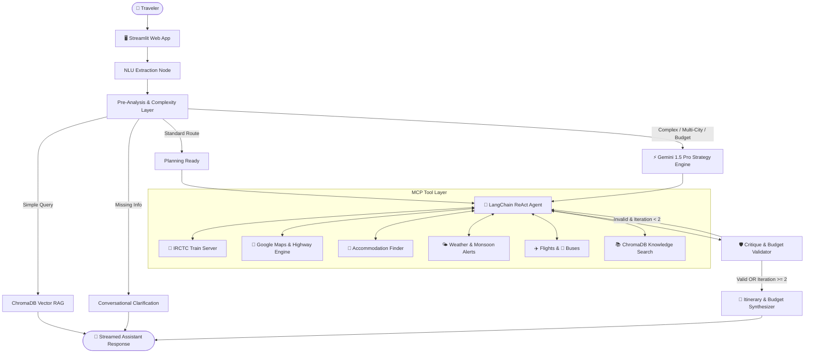

# 🌍 Yatra AI — Intelligent Domestic Travel Planner for India

[](https://www.python.org/)
[](https://github.com/langchain-ai/langgraph)
[](https://www.langchain.com/)
[](https://aistudio.google.com/)
[](https://streamlit.io/)
[](https://www.trychroma.com/)
[](tests/)
[](LICENSE)

**Yatra AI** is an AI-powered travel planning platform engineered specifically for the **Indian domestic travel ecosystem**. It combines a **hybrid LangGraph + LangChain agent architecture** with **dual-model routing (GPT-4o-mini + Google Gemini 1.5 Pro)**, real-time Model Context Protocol (**MCP**) transit tools, and a local **ChromaDB vector database** for authentic Indian travel guidance.

---

## 🏛️ System Architecture



---

## 🚀 Key Features

* **Dual-Model Intelligence**:
  * **GPT-4o-mini**: Fast NLU parameter extraction, conversation state updates, and LangChain ReAct tool synthesis.
  * **Gemini 1.5 Pro**: Deep reasoning for multi-city route sequencing (greedy nearest-neighbor optimization), tight budget survival, and accessibility constraints (elderly, wheelchair, infant care).
* **Authentic Indian Domestic Context**:
  * **IRCTC Trains**: Station resolution (`NDLS`, `JP`, `BOM`, `BSB`), classes (`3A`, `2A`, `CC`, `SL`, `1A`), fares, and Tatkal guidelines.
  * **National Highway Calculations**: Fuel cost formulas (`distance / 15 km/l * ₹100/L petrol`) + FASTag toll estimation and road advisories.
  * **Seasonal Advisories**: Monsoon awareness (June–Sept), North Indian winter fog (Nov–Jan), and summer heatwave warnings.
  * **Budget Table in INR (`₹`)**: 35% Transit, 35% Lodging, 20% Food & Dining, 10% Reserve Buffer.
  * **Strictly No Panchang / Astrology**: Clean logistical and cultural recommendations only.
* **Hybrid LangGraph + LangChain**:
  * **LangGraph**: Stateful conversation graphs, checkpoint persistence (`MemorySaver`), complexity routing, and validator guardrail loops.
  * **LangChain**: Autonomous ReAct tool execution with exponential backoff and timeout protections.
* **Dual Operation Modes**:
  * **Live API Mode**: Connects to live OpenAI, Google Gemini, and remote MCP servers.
  * **Domestic Offline Mode**: Operates out-of-the-box with 0 API keys using local deterministic travel engines and local ChromaDB embeddings.

---

## 🛠️ Quick Start Guide

### 1. Prerequisites
- Python 3.10, 3.11, or 3.12
- Git

### 2. Installation
```bash
# Clone the repository
git clone https://github.com/shivanshmishra123/YatraAI.git
cd YatraAI

# Create virtual environment
python -m venv .venv

# Activate virtual environment
# Windows (PowerShell):
.\.venv\Scripts\Activate.ps1
# Linux / macOS:
source .venv/bin/activate

# Install dependencies in editable mode
pip install -r requirements.txt
pip install -e .
```

### 3. Environment Configuration (Optional)
Yatra AI works **without any API keys** in domestic offline mode. To enable live models, copy `.env.example` to `.env`:
```bash
cp .env.example .env
```
Fill in your keys (see [API_KEYS.md](API_KEYS.md) for step-by-step instructions):
```ini
OPENAI_API_KEY=sk-...
GOOGLE_API_KEY=AIzaSy...
```

### 4. Run the Streamlit Application
```powershell
streamlit run app.py
```
Open **[http://localhost:8501](http://localhost:8501)** in your browser!

---

## 📊 Health Check CLI Tool

Verify connectivity and latency for all domestic MCP tool servers:
```powershell
python check_mcp_health.py
```

Sample output:
```text
=================================================================
🌍 Yatra AI — MCP Servers & Travel Engine Health Check
=================================================================
• IRCTC Server        : 🛡️ FALLBACK ACTIVE (Domestic Engine Ready) (0ms)
• Google Maps Server  : 🛡️ FALLBACK ACTIVE (Domestic Engine Ready) (0ms)
• Weather Server      : 🛡️ FALLBACK ACTIVE (Domestic Engine Ready) (0ms)
• Flight Server       : 🛡️ FALLBACK ACTIVE (Domestic Engine Ready) (0ms)
• Bus Server          : 🛡️ FALLBACK ACTIVE (Domestic Engine Ready) (0ms)
=================================================================
✅ Domestic fallback travel engines verified. Ready for offline demo.
```

---

## 🧪 Running the Test Suite

Yatra AI includes a comprehensive test suite of **98 unit, scenario, and hardening tests**:

```bash
# Run all tests
pytest -v

# Run individual test modules
pytest tests/test_gemini_and_phase4.py -v   # Dual-model routing & multi-city
pytest tests/test_scenarios.py -v           # 26 automated scenario queries
pytest tests/test_hardening.py -v           # Error recovery & database rebuilds
pytest tests/test_phase5_ui_and_features.py -v # Streaming & export
pytest tests/test_date_parser.py -v         # 25 date & budget test cases
pytest tests/test_city_resolver.py -v       # 35+ city alias tests
```

---

## 🐳 Docker Deployment

Run Yatra AI in an isolated container:

```bash
# Build Docker image
docker build -t yatra-ai .

# Run container
docker run -p 8501:8501 --env-file .env yatra-ai
```
Visit `http://localhost:8501` to access the running app.

---

## 📁 Repository Structure

```text
YatraAI/
├── app.py                     # Streamlit frontend with streaming & loading states
├── check_mcp_health.py        # CLI health check for MCP servers
├── Dockerfile                 # Production Docker container definition
├── .dockerignore              # Excludes secrets, caches, and virtualenvs
├── requirements.txt           # Pinned dependencies
├── setup.py                   # Editable package configuration
├── API_KEYS.md                # Guide to obtaining OpenAI, Gemini, Maps keys
├── CONTRIBUTING.md            # Contribution guidelines & architecture constraints
├── TROUBLESHOOTING.md         # Solutions for common errors (ports, loops, ChromaDB)
├── ARCHITECTURE.md            # Deep system architecture & sequence diagrams
├── PLAN.md                    # 6-phase development roadmap
├── PROJECT_SPEC.md            # Detailed functional specification
├── CLAUDE.md                  # Developer cheatsheet
├── data/
│   ├── travel_docs/           # Curated markdown guides (Jaipur, Goa, IRCTC, etc.)
│   └── travel_vectordb/       # Persistent ChromaDB vector database
├── tests/                     # 10 test modules (98 passing tests)
└── yatra_agent/
    ├── agent/                 # LangChain ReAct agent executor
    ├── config/                # Prompts, settings, servers_config.json
    ├── graph/                 # LangGraph StateGraph, nodes, and state definitions
    ├── tools/                 # MCP tool manager, ChromaDB RAG, Gemini reasoning
    └── utils/                 # City resolver (LRU cached), IST date parser
```

---

## 📄 License

This project is licensed under the MIT License — see the [LICENSE](LICENSE) file for details.
